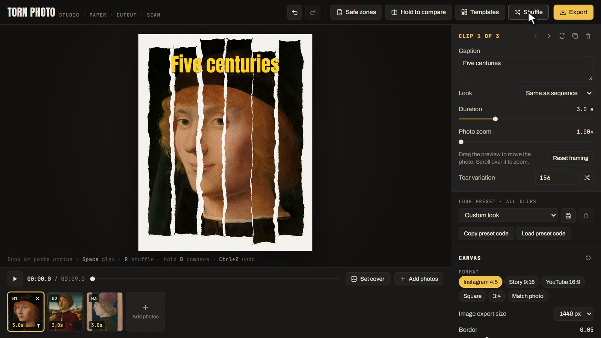
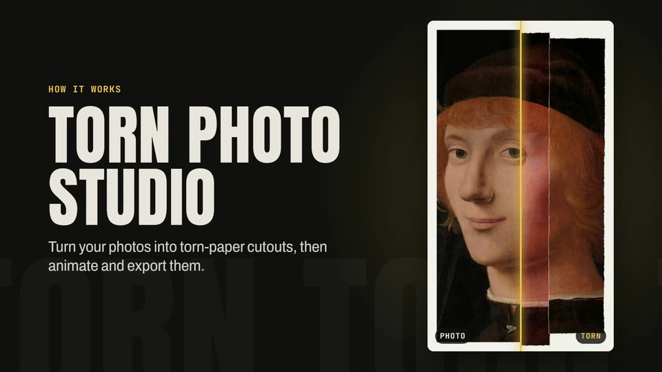
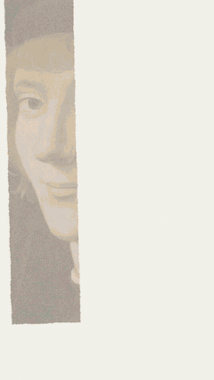
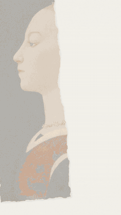
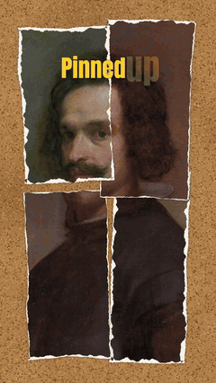
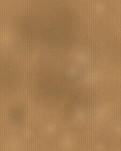
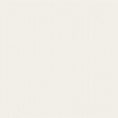
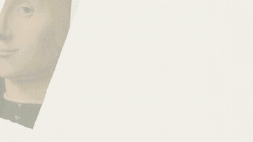

# Torn Photo Studio

Turn your photos into torn-paper cutouts on a scanned-paper background: strips, grids, a photo ripped in half or a
torn hole, with captions. Line several photos up into a short animated sequence, cut it to music, and export PNG,
MP4, GIF or carousel slides.

**Everything runs on your computer. No account, no API key, nothing is uploaded.**

<!-- videos:start -->
## See it in action

 <b>▶ <a href="docs/videos/tutorial.mp4">How it works</a></b> (0:56, with captions)

**Made with Torn Photo Studio, from public-domain portraits (The Met)**

<table><tr>
<td width="33%" align="center"> <a href="docs/videos/examples/reel-torn-strips.mp4">3-photo reel, 9:16</a></td>
<td width="33%" align="center"> <a href="docs/videos/examples/story-ripped-in-half.mp4">Ripped in half, 9:16</a></td>
<td width="33%" align="center"> <a href="docs/videos/examples/cork-board-boil.mp4">Cork board, boiling tears, 9:16</a></td>
</tr><tr>
<td width="33%" align="center"> <a href="docs/videos/examples/zine-slideshow.mp4">Zine slideshow, 4:5</a></td>
<td width="33%" align="center"> <a href="docs/videos/examples/photo-dump-grid.mp4">Photo dump grid, 1:1</a></td>
<td width="33%" align="center"> <a href="docs/videos/examples/wide-portrait-lineup.mp4">Mixed strips, 16:9</a></td>
</tr></table>

Click any picture to play the video. Example sources: public-domain paintings from
[The Metropolitan Museum of Art Open Access](https://www.metmuseum.org/about-the-met/policies-and-documents/open-access)
(CC0): [*Portrait of a Young Man*](https://www.metmuseum.org/art/collection/search/435581) by Antonello da Messina, [*Portrait of a Young Man*](https://www.metmuseum.org/art/collection/search/435664) by Biagio d'Antonio, [*Portrait of a Young Man*](https://www.metmuseum.org/art/collection/search/436769) by Jacometto, [*Portrait of a Young Man*](https://www.metmuseum.org/art/collection/search/437851) by Cosmè Tura, [*Portrait of a Woman*](https://www.metmuseum.org/art/collection/search/437859) by Giovanni di Francesco del Cervelliera, [*Portrait of a Woman*](https://www.metmuseum.org/art/collection/search/437000) by the Master of the Castello Nativity, [*Portrait of a Woman*](https://www.metmuseum.org/art/collection/search/436630) by Adriaen Hanneman, [*Portrait of a Man*](https://www.metmuseum.org/art/collection/search/437874) by Velázquez, [*Self-portrait*](https://www.metmuseum.org/art/collection/search/700489) by Sanford Robinson Gifford.
<!-- videos:end -->

## Install

You need:
- Windows 10 or 11 (it is built and tested on Windows 11 in Chrome)
- Google Chrome or Microsoft Edge

There is nothing to install and no server to start. Download or clone this folder, then **double-click `index.html`**
(or drag it into a Chrome or Edge window). The app runs straight from the file.

The only thing the page loads from the internet is its fonts, from Google Fonts. Without a connection it still works
and uses fallback fonts (such as Impact and Arial).

## How it works
1. **Add photos**: click **Add photos**, drop image files on the window, or paste one (Ctrl+V). JPG, PNG, WebP and
   GIF work. The app starts with three drawn sample clips; your first photos replace them.
2. The **strip** at the bottom is the sequence. Each card is one clip, and its width shows how long it lasts.
   - Click a card to select it, drag it to reorder, and × removes it.
   - **▶** (or **Space**) plays the sequence. The slider scrubs through it.
   - **Set cover** keeps what the preview shows as the cover image (used by the Image export and multi-format videos).
3. The **Clip** panel (top right) edits the selected clip:
   - **Caption**: the words shown on this photo.
   - **Look**: use the sequence look, or give this clip its own look. The panels below then edit only this clip.
   - **Duration** (0.5 to 10 s), or **Length in beats** when clips are cut to the music.
   - **Photo zoom**. Drag the preview to move the photo and scroll over it to zoom. **Reset framing** centres it
     again.
   - **Tear variation**: a number that gives this clip a different tear.
   - The small buttons move the clip earlier or later, replace its photo, duplicate it or remove it.
4. **Look preset**: 11 built-in looks (Torn strips, Collage grid, Diagonal tear, Ripped in half, Torn hole, Shredded
   rows, Cork board scrap, Cardboard zine, Dark desk, Missing pieces, Clean scan).
   - The save button keeps the current look as one of **My presets**. The bin deletes a saved one.
   - **Copy preset code** gives a text code that starts with `torn:`. **Load preset code** applies one.
5. Fine-tune the look in the sections below. ↺ resets a section, and the switch turns it on or off.
   - **Canvas**: format (4:5, 9:16, 16:9, 1:1, 3:4 or the photo's own shape), image export size (1080 to 3840 px),
     border and photo zoom.
   - **Background**: paper (any colour), cardboard, cork board, concrete, dark desk, or your own image.
   - **Photo**: brightness, contrast, saturation and warmth.
   - **Paper scan**: a scanned-paper texture over everything: opacity, grain, grain size, fibres, stains and falloff.
     **Load my own paper scan** uses your own scan instead.
   - **Paper cutout**:
     - **Layout**: strips and grid (1 to 8 columns and rows), or ripped in half (with a rip gap).
     - **Cut angle**, **Missing pieces** (leaves holes in the grid) and **Seed** (a new tear pattern).
     - **Mix photos from the sequence**: each strip shows another photo, scaled to the whole frame or to its strip.
     - **Variation**: rotation, size, width and height variation, UV shift (each piece's picture slides a little) and
       colour variation.
     - **Edges**: tear size, chunk size, roughness, white edge, unevenness, tear direction (the white torn edge shows
       on one side of each tear, like real torn paper), paper core tone, shadow and paper edge colour.
   - **Torn hole**: a ragged hole torn through the photo: size, position and raggedness.
   - **Motion**: **Animate the tears (seed boil)** re-tears the paper 1 to 24 times per second for a stop-motion look.
     Loop length, seed keyframes (step through seeds you picked) and stop-motion wobble.
   - **Text**: font (Anton, Archivo Black, Bebas Neue, Marker, Typewriter), size, colour, position, animation (stamp
     word by word, typewriter, rise up, fade in, none), outline, shadow, a torn paper label behind the text, and
     printing the text under the paper texture.
   - **Sequence**: transition (strips drop in, crossfade, slide, hard cut) and its length, a slow zoom and pan (Ken
     Burns), and tearing the strips apart at the end of each clip. **Give every clip a random look** mixes the presets
     across your clips.
   - **Music**: add a song (MP3, WAV, M4A or OGG). The app finds its tempo and its hits.
     - Click the waveform to choose where the song starts. Type, tap or detect the tempo, and nudge the beat offset.
     - **Cut clips on the beat** sets each clip's length in beats.
     - **Tears change** on hits in the music, on the beat grid, or at a steady rate.
     - The visuals react to the sound: punch (zoom on kicks and bass), spread (strips pull apart with the bass),
       shake, flash on hits, caption pop and beat-grid bump. Also volume and a fade-out at the end.
6. The top bar:
   - **Undo** and **Redo**.
   - **Safe zones** shows where short-video apps put their buttons and labels (9:16), the 3:4 middle a profile grid
     shows (4:5), or a title-safe area.
   - **Hold to compare** (or hold **B**) shows the original photo.
   - **Templates**: six ready-made sequences (3-photo reel, Beat montage, Zine slideshow, Story teaser, Photo dump,
     YouTube intro). A template sets the format, look, timing, transitions and caption style; Ctrl+Z undoes it.
   - **Shuffle** (or **R**) picks a new tear seed.
7. Keys: **Space** play or pause, **R** shuffle, hold **B** compare, **←/→** previous or next clip, **Delete**
   removes the selected clip, **Ctrl+Z** undo, **Ctrl+Shift+Z** or **Ctrl+Y** redo.

Your photos, music, settings and presets are kept in the browser, so the sequence is still there the next time you
open the page. Your own background image and paper scan are not kept: load them again after reopening.

## Export
**Export** opens a dialog with five tabs:
- **Video**: 720p to 2160p, at 24, 30 or 60 fps. Pick one or more formats (9:16, 4:5, 1:1, 16:9). Several formats
  come as one ZIP, with a cover PNG for each when a cover is set.
  - The video is an MP4 (H.264, or VP9 when the browser can't encode H.264), rendered frame by frame with WebCodecs,
    faster than real time. The music is included (AAC, or Opus when AAC is not available). On the test PC, a 3 s
    1080×1350 video took about 2 s.
  - A browser without WebCodecs records a WebM in real time instead.
- **GIF**: 360 to 1080 px, 8 to 20 fps. It loops forever and uses 256 colours per frame.
- **Image**: a PNG of what the preview shows, or of the cover frame. Set its size under Canvas → Image export size.
- **Batch ZIP**: the current look on every photo, one numbered PNG each.
- **Carousel**: one long torn collage cut into 2 to 10 slides (1 to 4 strips each), so the tears carry on from one
  slide to the next. Your photos fill one strip each, or the selected photo is used as a panorama. You get a ZIP with
  the panorama and the numbered slides.

When the export is ready, **Download** saves it where your browser saves downloads (usually the `Downloads` folder).
If Download does nothing, right-click the preview and choose Save.

## What's where
- `index.html`: the page. It is built from `src/body.html` by `src/build.sh`, which adds the head (title, fonts and
  styles). After editing `src/body.html`, run `sh src/build.sh` (Git Bash on Windows) to rebuild `index.html`.
- `app.css`: the styles.
- `app.js`: the whole app: settings and presets, the tear geometry (noise-shaped edges with white paper fibres), the
  paper scan and backgrounds, captions, the sequence and transitions, the music analysis (tempo, hits, levels), the
  preview, undo, saving in the browser, and every export (with a small ZIP writer).
- `lib/`: the two bundled libraries, with their licences:
  - `mp4-muxer.js` (`LICENSE-mp4-muxer.txt`) writes the MP4 files.
  - `gifenc.umd.js` (`LICENSE-gifenc.md`) writes the GIFs.
- `torn-photo.ico`: the icon.
- Your data stays in the browser's storage for this page: photos and music in IndexedDB (`torn-studio`), settings,
  presets and export options in localStorage. Clearing the browser's site data removes them.

## Tests
There are no automated tests. To check a change, open `index.html` in Chrome, add a photo, play the sequence, and
export each type from the Export dialog.

## Credits
- [mp4-muxer](https://github.com/Vanilagy/mp4-muxer) 5.2.2 by Vanilagy (MIT), for MP4 export.
- [gifenc](https://github.com/mattdesl/gifenc) 1.0.3 by Matt DesLauriers (MIT), for GIF export.
- Fonts from [Google Fonts](https://fonts.google.com/): Anton, Archivo, Archivo Black, Bebas Neue and JetBrains Mono
  (SIL Open Font License), Permanent Marker and Special Elite (Apache License 2.0).
- Photos in the tutorial and examples: nine public-domain portraits from
  [The Metropolitan Museum of Art Open Access](https://www.metmuseum.org/about-the-met/policies-and-documents/open-access)
  (CC0), by Antonello da Messina, Biagio d'Antonio, Jacometto, Cosmè Tura, Giovanni di Francesco del Cervelliera, the
  Master of the Castello Nativity, Adriaen Hanneman, Velázquez and Sanford Robinson Gifford (links above).

## Licence

MIT, see [LICENSE](LICENSE).
